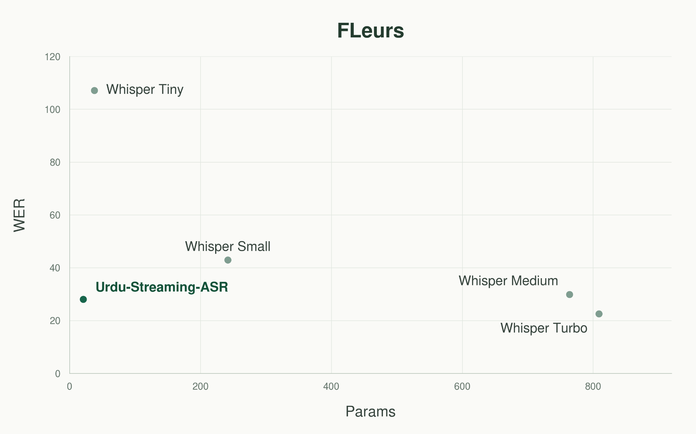

# Urdu Streaming ASR


<!-- URDU_ASR_BRANDING_START -->
[](https://huggingface.co/mahwizzzz/Urdu-Streaming-Zipformer-20M)
[](https://huggingface.co/datasets/mahwizzzz/Urdu-Streaming-ASR-Data)
[](#file-transcription)
[](LICENSE)
<!-- URDU_ASR_BRANDING_END -->
### Compact Urdu Speech Recognition with Zipformer

An open-source Urdu automatic speech recognition project
built around a streaming Zipformer transducer.


## Model Weights

The trained model binaries are hosted on Hugging Face.

**[Download model weights](https://huggingface.co/mahwizzzz/Urdu-Streaming-Zipformer-20M/tree/v1.2.0-rc1)**

Verified release: `v1.2.0-rc1`


## Installation

Python and compatible PyTorch, sherpa-onnx, and related
dependencies are required.

```bash
git clone https://github.com/mwzkhalil/Urdu-Streaming-ASR.git
cd Urdu-Streaming-ASR

python -m venv .venv
source .venv/bin/activate

python -m pip install -r requirements/inference.txt
python -m pip install -e .
python -m pip install huggingface_hub
```


## Download the Model

```bash
hf download mahwizzzz/Urdu-Streaming-Zipformer-20M \
  --revision v1.2.0-rc1 \
  --include "onnx/*" \
  --local-dir models

cp -a tokenizer models/tokenizer
```

The PyTorch checkpoint can be obtained separately using
`--include "weights/*"` with the same pinned revision.

## File Transcription

INT8 quality decoding:

```bash
python examples/transcribe_file.py \
  examples/sample_urdu.wav \
  --model models \
  --mode quality
```

FP32 decoding:

```bash
python examples/transcribe_file.py \
  examples/sample_urdu.wav \
  --model models \
  --mode quality \
  --fp32
```

Fast greedy decoding:

```bash
python examples/transcribe_file.py \
  examples/sample_urdu.wav \
  --model models \
  --mode fast
```

## Streaming Recognition

Chunk-based streaming from an audio file:

```bash
python examples/stream_paced_or_mic.py \
  --audio examples/sample_urdu.wav \
  --model models \
  --mode quality
```

To simulate real-time chunk arrival, add `--real-time`.

Microphone input is supported through the
`--microphone` CLI option, subject to an available audio
device and supported runtime.

<!-- URDU_ASR_FIGURE_START -->


*FLEURS model-size comparison. Interpret WER values using the documented evaluation protocol and decoder settings; model size alone does not make the baselines strictly comparable.*
<!-- URDU_ASR_FIGURE_END -->

## Evaluation Results

The following results are for the selected released
model using INT8 ONNX, modified beam search with four
active paths, blank penalty 0.25, and normalized
WER/CER scoring.

| Benchmark | WER ↓ | CER ↓ |
|:--|--:|--:|
| CSALT Voice | 27.82% | 18.33% |
| FLEURS Urdu — test subset | 27.95% | 12.10% |
| IndicVoices Urdu | 17.42% | 9.51% |
| KathBath Urdu | 21.48% | 6.67% |
| RASA Urdu | 12.83% | 4.84% |
| UrduSpeech — code-switch | 33.48% | 21.80% |
| FLEURS Urdu — 299 utterances | 28.03% | 11.96% |

Lower is better.

The two FLEURS rows describe different evaluation
subsets and must not be treated as independent
combined benchmarks.

The authoritative evidence is retained in
[reports/evaluation.json](reports/evaluation.json).
Historical experiment identifiers are preserved
there for auditability.

## Streaming Performance

A recorded single-sample streaming run produced:

| Measurement | Observed value |
|:--|--:|
| Audio duration | 4.74 s |
| Processed chunks | 15 |
| Mean chunk compute time | 10.66 ms |
| Total compute real-time factor | 0.03837 |

These figures describe one sample run. They are
not population-level latency guarantees or full
live-microphone end-to-end measurements.

## Training

Training code is provided in `training/`,
`scripts/`, `configs/`, and the bundled Icefall recipe.

Install the compatible training dependencies using
`requirements/train.txt`, following the project's
environment documentation.

Inspect the available training options:

```bash
python training/train.py --help
```

The training entry point has been import-tested.
Complete training-from-scratch reproduction has
not yet been independently validated from this
cleaned source distribution.

Training requires appropriately prepared dataset
manifests and the compatible Icefall/k2 environment.

<!-- URDU_ASR_DATA_START -->
## Combined Training Data

The curated training mixture contains **66,601 accepted utterances** (approximately **131.01 hours**). The [combined training metadata](https://huggingface.co/datasets/mahwizzzz/Urdu-Streaming-ASR-Data) provides source provenance and a manifest. It does **not** redistribute audio, transcriptions, or held-out evaluation recordings. See [data sources](docs/DATA_SOURCES.md) for upstream terms.
<!-- URDU_ASR_DATA_END -->

## Project Structure

| Directory | Purpose |
|:--|:--|
| `src/urdu_streaming_asr/` | Reusable application code |
| `training/` | Training entry point |
| `scripts/` | Preparation, training and evaluation |
| `configs/` | Model and experiment configuration |
| `tokenizer/` | BPE and token metadata |
| `third_party/icefall_recipe/` | Required upstream model components |
| `examples/` | File and streaming inference |
| `tests/` | Automated tests |
| `reports/` | Authoritative evaluation evidence |
| `docs/` | Technical methodology and provenance |

## Evaluation and Reproducibility

The project documents corpus provenance, data
partitioning, normalization, decoding settings,
checkpoint selection, and evaluation evidence.

Comparisons must use matched evaluation conditions.
Historical baseline discrepancies are retained
in the audit record rather than silently replaced.

See `docs/` and `reports/evaluation.json`.

## Limitations

Recognition performance varies with acoustic
conditions, speech style, dialect, recording
quality, and code-switching.

The available benchmark results should not be
generalized to unsupported languages or domains.

## Acknowledgements

The training architecture builds on components
from the open-source Icefall project. Applicable
third-party copyright and license notices are
retained alongside bundled source files.

## Authors and attribution

**Project author and maintainer:** **Muhammad Mahwiz Khalil** (Proxima AI)  
GitHub: [@mwzkhalil](https://github.com/mwzkhalil) · Hugging Face: [@mahwizzzz](https://huggingface.co/mahwizzzz)

This project integrates original Urdu ASR work with upstream open-source components. Copyright and authorship claims here apply to original project-specific contributions, not to third-party code or datasets.

## License

Original project-specific source code: **Copyright © 2026 Muhammad Mahwiz Khalil**.  
Licensed under **Apache License 2.0**; see [LICENSE](LICENSE) and [NOTICE](NOTICE) for copyright and attribution.  
Bundled Icefall modules retain their original copyright and license notices in [third_party/icefall_recipe/](third_party/icefall_recipe/).  
[Model weights](https://huggingface.co/mahwizzzz/Urdu-Streaming-Zipformer-20M) and [training-data sources](https://huggingface.co/datasets/mahwizzzz/Urdu-Streaming-ASR-Data) have their own applicable terms; the source-code license does not automatically apply to them.

## Citation

If you use the code, cite the software below. If you use the pretrained model, cite the model as well. No journal paper or DOI is implied by these citations.

**Source code**

```bibtex
@software{khalil2026urdustreamingasr,
  author = {Khalil, Muhammad Mahwiz},
  title = {Urdu Streaming ASR: A Compact Zipformer Transducer for Urdu Speech Recognition},
  year = {2026},
  url = {https://github.com/mwzkhalil/Urdu-Streaming-ASR},
  note = {Source code, training, inference, and evaluation resources}
}
```

**Pretrained model**

```bibtex
@misc{khalil2026urdustreamingzipformer,
  author = {Khalil, Muhammad Mahwiz},
  title = {Urdu Streaming Zipformer 20M},
  year = {2026},
  howpublished = {Hugging Face model repository},
  url = {https://huggingface.co/mahwizzzz/Urdu-Streaming-Zipformer-20M},
  note = {Verified model release v1.2.0-rc1}
}
```

GitHub also provides a **Cite this repository** control via [CITATION.cff](CITATION.cff). The Zipformer/Icefall architecture and any reused datasets should be cited independently under their own terms.
